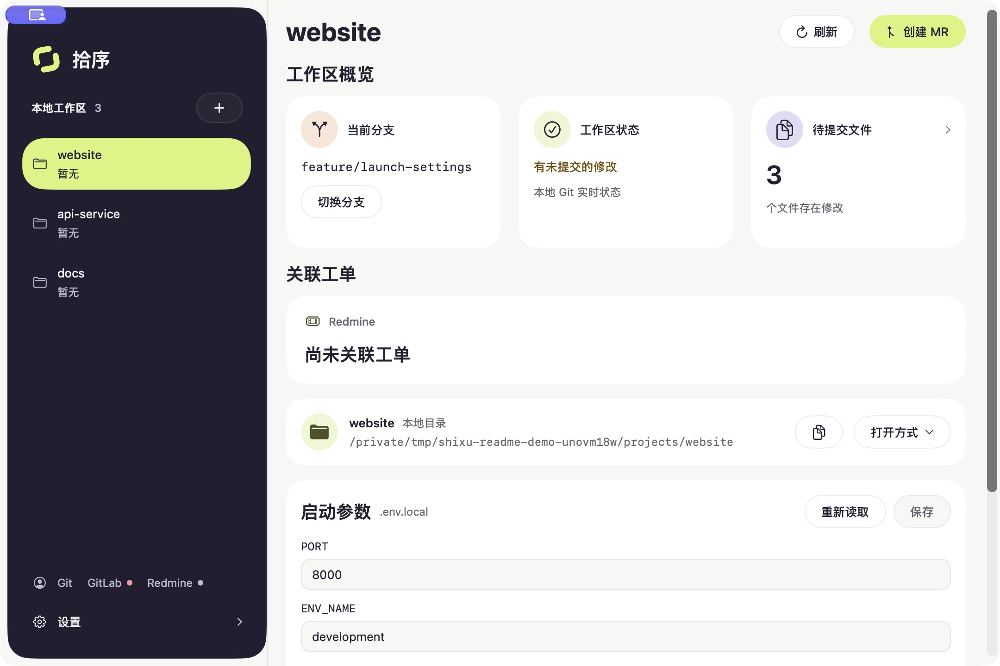
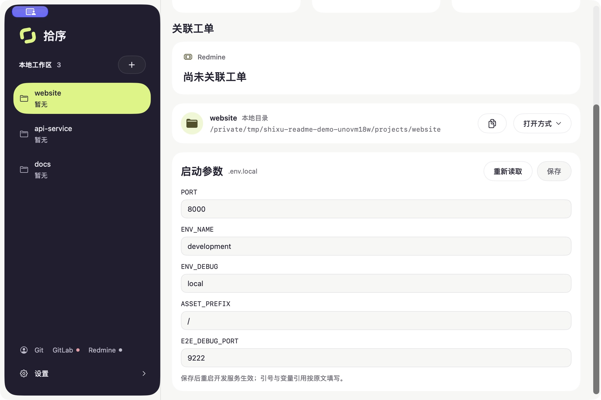

# 拾序

把仓库、工单与代码评审放到一个工作台。

拾序是一款原生 macOS 开发工具，面向同时维护多个 Git 仓库、使用 GitLab 和 Redmine 的开发者。查看当前分支与代码变更、找到对应工单、登记工时、创建 Merge Request，都可以从同一个窗口完成，减少在编辑器、终端和网页之间来回查找。

*截图使用演示工作区，不含真实项目与服务凭据。*

## 能做什么

- **管理多个工作区**：添加本地 Git 仓库，快速切换和拖拽排序，查看当前分支与工作区状态。
- **查看代码变更**：分别浏览已暂存、未暂存的文件和只读 diff，支持选择与复制。
- **查找与切换分支**：搜索本地、远程分支；切换前检查未提交修改。
- **关联 Redmine 工单**：从分支末尾的工单编号关联详情，一键打开工单并登记日期、工时、活动和备注。
- **创建 GitLab MR**：填写标题、描述、目标分支与处理人；创建前检查远端分支、代码差异、重复 MR 和合并冲突。
- **调整启动参数**：工作区存在 `.env.local` 时，直接编辑已有参数并保存；文件不存在时隐藏入口。
- **衔接日常工具**：复制仓库路径，使用 Finder 或已安装的编辑器打开目录。
- **适应你的桌面**：支持浅色、深色和跟随系统，可独立控制菜单栏与 Dock 图标，并在应用内检查更新。

拾序使用已有的 Git 提交创建 MR，不会自动 commit、push 或合并；查看 diff 也不会暂存或丢弃文件。GitLab、Redmine 未配置时，仍可使用本地仓库功能。

## 在界面修改启动参数

工作区存在 `.env.local` 时，可直接编辑已有参数并保存；文件不存在时隐藏入口。保留原有注释与换行，外部修改冲突时阻止覆盖，敏感参数默认隐藏。保存后重启开发服务生效。

## 下载与安装

**[下载拾序 0.1.1 · Apple Silicon（DMG）](https://github.com/UnicornZhang/shixu-releases/releases/download/v0.1.1/Shixu-0.1.1-arm64.dmg)**

1. 打开 DMG，将「拾序.app」拖到「Applications」。
2. 从应用程序目录启动拾序，点击左侧「+」添加本地 Git 仓库。
3. 如需工单、工时或 MR 功能，在「设置 → 管理连接」中分别配置 Redmine 和 GitLab。

也可下载 [ZIP 便携包](https://github.com/UnicornZhang/shixu-releases/releases/download/v0.1.1/Shixu-0.1.1-arm64.zip)，解压后将应用放入应用程序目录。全部版本与校验文件见 [Releases](https://github.com/UnicornZhang/shixu-releases/releases)。

## 当前版本的系统要求

- Apple Silicon Mac（M 系列芯片）；当前版本不支持 Intel Mac。
- macOS 27.0 或更新版本。更低系统版本的兼容性正在评估，尚未发布兼容包。
- 使用本地 Git 功能需安装 Git；同步远端分支沿用本机 Git 的认证配置。
- 工单、工时与 MR 功能需要对应服务账号及操作权限。

## 更新与数据

在「设置 → 软件更新」或应用菜单中检查更新，也可开启自动检查。发现新版本后提示安装，重启前会检查正在进行的操作与会话草稿。

工作区与服务配置保存在本机。服务 Token 以明文写入仅当前用户可读写的配置文件，界面默认隐藏；请勿分享配置文件。MR 与工时草稿只在本次运行中保留，重启前请完成或确认丢弃。

## 首次打开

应用已使用 Developer ID 签名，尚未进行 Apple 公证。如果 macOS 阻止首次打开，请确认下载来源是本仓库，再按系统提示到「系统设置 → 隐私与安全性」允许打开。

## 反馈

欢迎通过 [Issues](https://github.com/UnicornZhang/shixu-releases/issues) 提交问题或建议，附上应用版本、macOS 版本、芯片类型和复现步骤。截图与日志中请隐藏 Token、内部服务地址和其他敏感信息。
